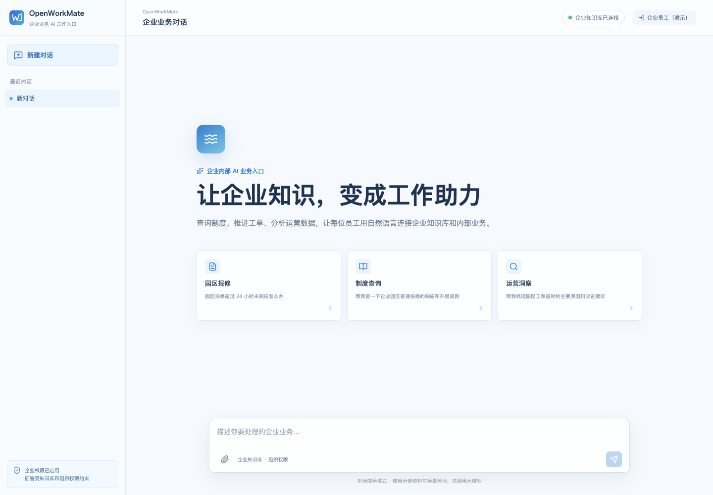
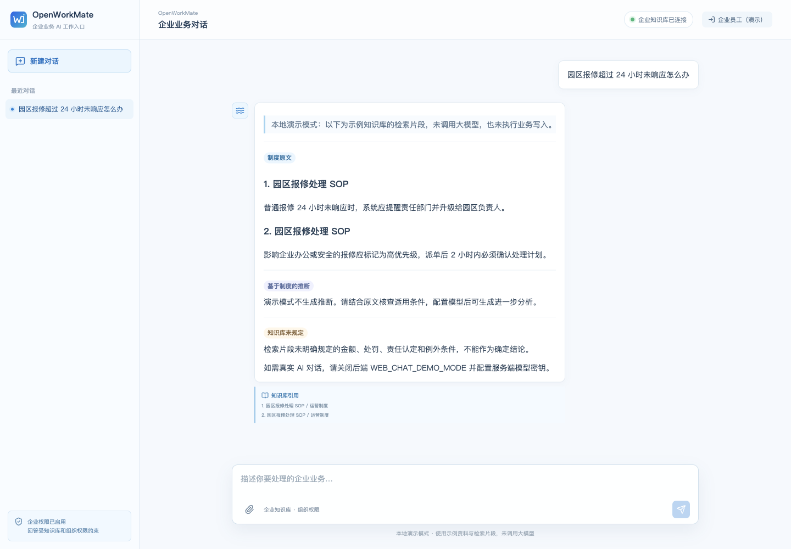
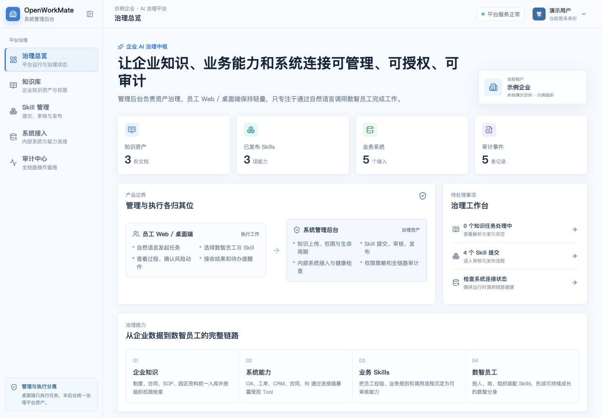
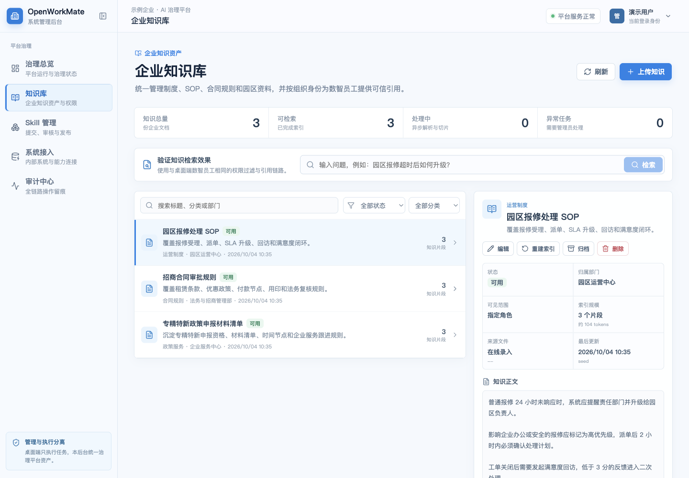
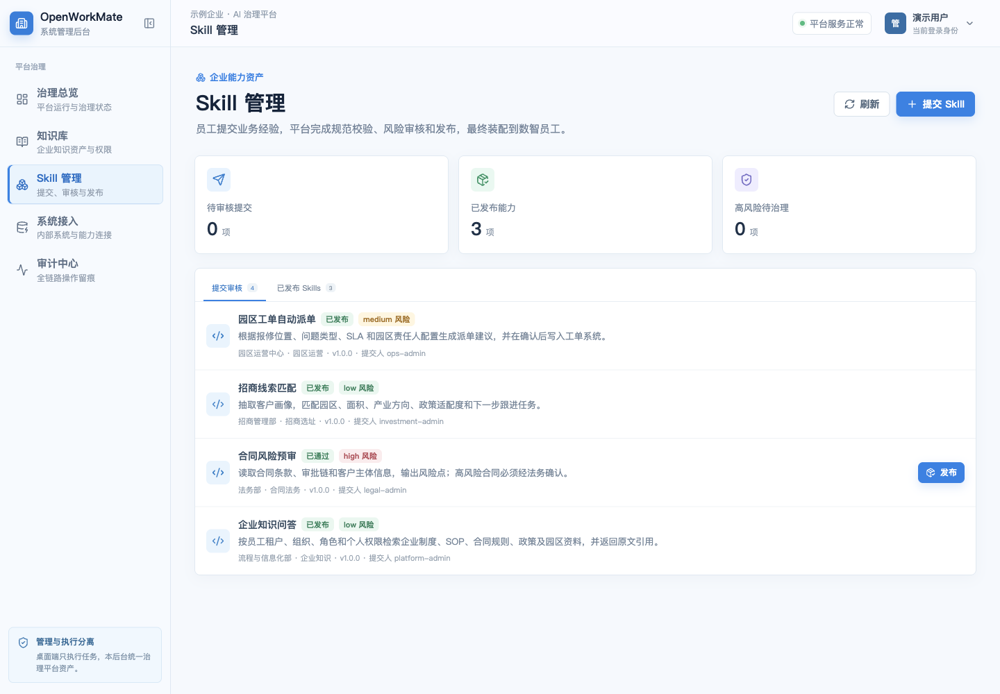
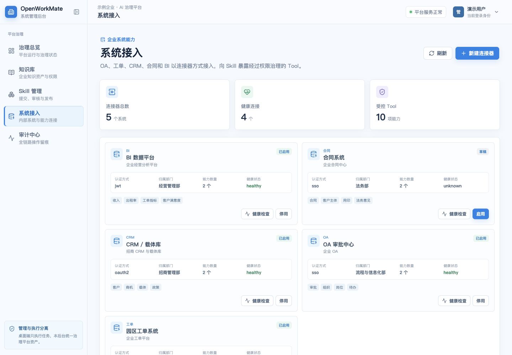
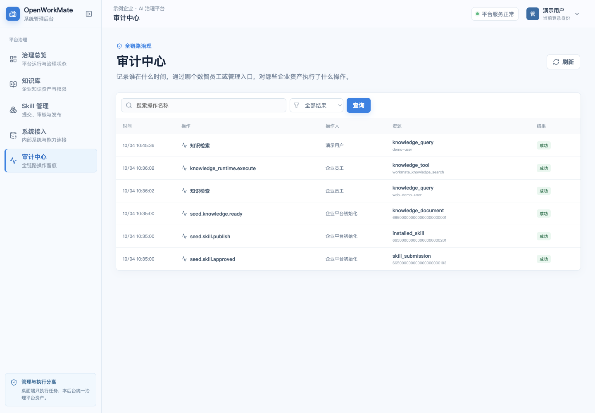
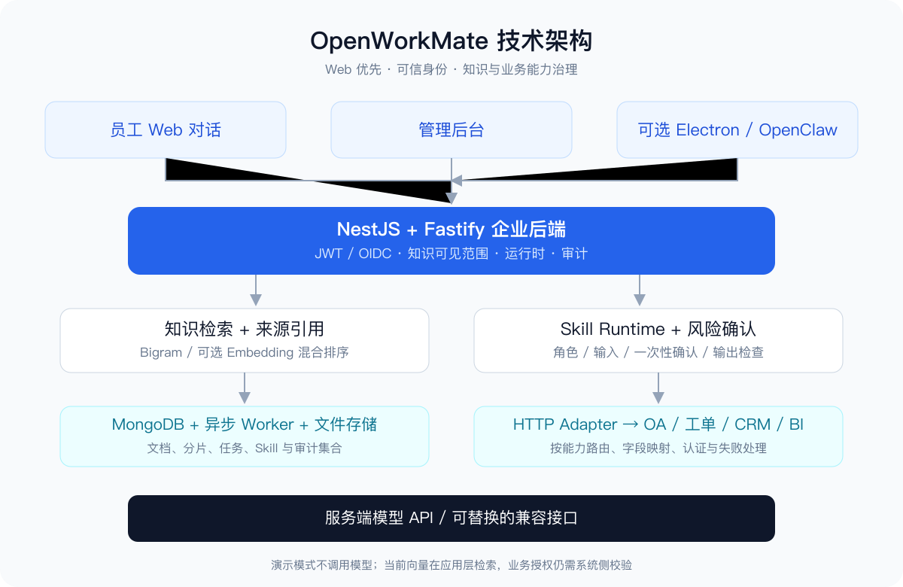

# OpenWorkMate

让企业知识、业务经验和内部系统，成为员工可以用自然语言调用的工作助力。

**企业内部的 AI 工作伙伴 · 可私有部署 · MIT 开源 · Web 优先 · 保留 Electron**

OpenWorkMate 面向企业内部的制度查询、工单处理、合同规则检索和业务能力治理。可以把它理解为“企业内部的 WorkBuddy”：员工描述任务，平台检索可见知识并调用经过治理的业务能力。它是独立社区项目，与腾讯 WorkBuddy 没有官方关系，也不宣称具备相同功能。

这是早期可运行版本，欢迎一起维护、提出想法和分享脱敏业务场景。



## 能做什么

| 能力 | 当前实现 |
| --- | --- |
| 企业知识库 | PDF/DOCX/XLSX/CSV/Markdown/JSON/文本导入，异步解析、分片、索引，引用与可见范围过滤 |
| 员工对话 | 独立 Web，Markdown 预览、依据分类、来源引用、当前页面会话切换 |
| Skill 工厂 | manifest 校验、审核、发布、启停、角色门控、Runtime 调用与结构化输出检查 |
| 系统接入 | OA/工单/CRM/合同/BI 演示 Adapter；真实 HTTP 路由、字段映射、业务成功判断 |
| 风险确认 | 写操作绑定执行人、参数和连接器配置；确认令牌原子消费 |
| 身份与审计 | JWT/OIDC、管理入口身份检查、知识可见范围和调用审计 |
| 可选桌面端 | 基于 Electron/ClawX/OpenClaw，保留本地运行时和 Main 代理边界 |

默认演示模式只展示检索片段，不调用大模型；演示连接器返回 mock。接真实系统需按其接口、身份和权限契约配置，不能把示例当成已接入的生产能力。

## 功能截图

所有截图来自本项目实际运行界面，使用独立演示数据库与示例资料。

| 知识问答 | 管理总览 |
| --- | --- |
|  |  |
| 知识资产 | Skill 审核 |
|  |  |
| 系统连接 | 审计留痕 |
|  |  |

[查看更多截图与公众号介绍](docs/wechat-article.md)

## 使用说明

建议 Node.js 22、pnpm 10.31.0、MongoDB 7+。只体验 Web 不需要安装 Electron、启动 OpenClaw 或部署独立向量库。

```bash
git clone https://github.com/chencheng666/openworkmate.git
cd openworkmate
corepack enable
pnpm install --frozen-lockfile
cp backend/.env.example backend/.env
cp web-app/.env.example web-app/.env
```

启动 MongoDB（二选一：已有本地 MongoDB，或 Docker）：

```bash
docker compose -f backend/docker-compose.yml up -d
```

默认 MongoDB 地址为 `mongodb://127.0.0.1:27017/workmate_agent_platform`。初始化是幂等的，只写演示租户样例；不要对生产数据直接运行。

```bash
pnpm backend:seed
```

分别在三个终端中启动：

```bash
pnpm backend:dev  # API：127.0.0.1:18790/api
pnpm web:dev      # 员工入口：localhost:5180
pnpm admin:dev    # 治理后台：localhost:5174
```

开发身份可直接体验管理页面。该模式只用于本机，不是生产登录方案。使用自定义 MongoDB 地址时，需要同时向 `backend:seed` 注入 `MONGODB_URI`，例如 `MONGODB_URI=mongodb://127.0.0.1:27018/workmate_agent_platform pnpm backend:seed`；后端服务会读取 `backend/.env`。

### 切换真实模型

在 `backend/.env` 中设置 `WEB_CHAT_DEMO_MODE=false` 并填写 `DEEPSEEK_API_KEY`，Web 对话当前使用服务端 DeepSeek/兼容接口。需要其他兼容模型时可调整 `DEEPSEEK_BASE_URL` 与 `DEEPSEEK_MODEL` 并验证 Tool 协议。将 `web-app/.env` 中 `VITE_DEMO_MODE` 改为 `false`，重启相应服务。

**开发使用 GPT‑6，与运行时模型是两回事。** 本轮开源整理、去品牌化、验证与文档由维护者使用 GPT‑6 协作完成；项目保留上游与早期迭代的贡献。详见 [来源与致谢](NOTICE.md)。

### 本地桌面开发

```bash
pnpm init
pnpm dev
```

该命令会准备桌面依赖和 OpenClaw，体积与启动时间明显高于 Web。当前公开发布的是源码与 Web 体验路径，不包含预编译桌面安装包。安装包签名、公证和自动更新属于单独发布工作。

## 技术架构



```text
员工 Web / 治理后台 / 可选 Electron
                ↓
      NestJS + Fastify 企业 API
        ↙                   ↘
知识检索 + 引用          Skill Runtime
     ↓                       ↓
MongoDB + Worker       确认 + HTTP Adapter
     ↓                       ↓
可选 Embedding         OA / 工单 / CRM / BI
                ↓
       服务端模型调用与审计
```

知识库默认采用中文 Bigram 检索；可选 Embedding 存入 MongoDB，由应用层做混合排序。目前没有专用向量数据库或面向大规模知识库的向量索引。Web 会话目前位于页面内存，不是服务端持久化会话。

[详细架构与边界](docs/architecture.md) · [HTTP 接入示例](docs/connector-http-integration.md) · [未来规划](docs/roadmap.md)

## 参与维护

欢迎在 [Issue](https://github.com/chencheng666/openworkmate/issues) / [Discussions](https://github.com/chencheng666/openworkmate/discussions) 分享你想做的业务任务、系统接入问题、知识检索案例和产品体验。欢迎补充连接器、测试、部署教程与文档，不必等到有完整方案才参与。

[贡献指南](CONTRIBUTING.md) · [安全反馈](SECURITY.md)

```bash
pnpm test:enterprise
pnpm web:build
pnpm admin:build
pnpm --dir backend typecheck
pnpm --dir backend build
pnpm check:public
```

项目保留上游桌面测试；本轮验证了企业链路单元测试、Web E2E 和 Electron 冒烟测试。提供 [CI 模板](docs/ci/enterprise-check.yml)，覆盖企业链路和 Web/管理后台/后端构建。发布凭证未包含工作流上传权限，因此仓库尚未启用自动 Actions；维护者获得权限后可复制模板到 `.github/workflows/check.yml`。完整桌面测试是否支持其他操作系统，需要独立验证。

## 许可证

MIT。基于 [ClawX](https://github.com/ValueCell-ai/ClawX) 企业场景扩展，保留 ValueCell Team 原始版权声明；依赖遵循各自许可证。此项目未完成生产安全审计，生产接入需要完成身份、业务权限、存储、备份和模型数据边界验证。
