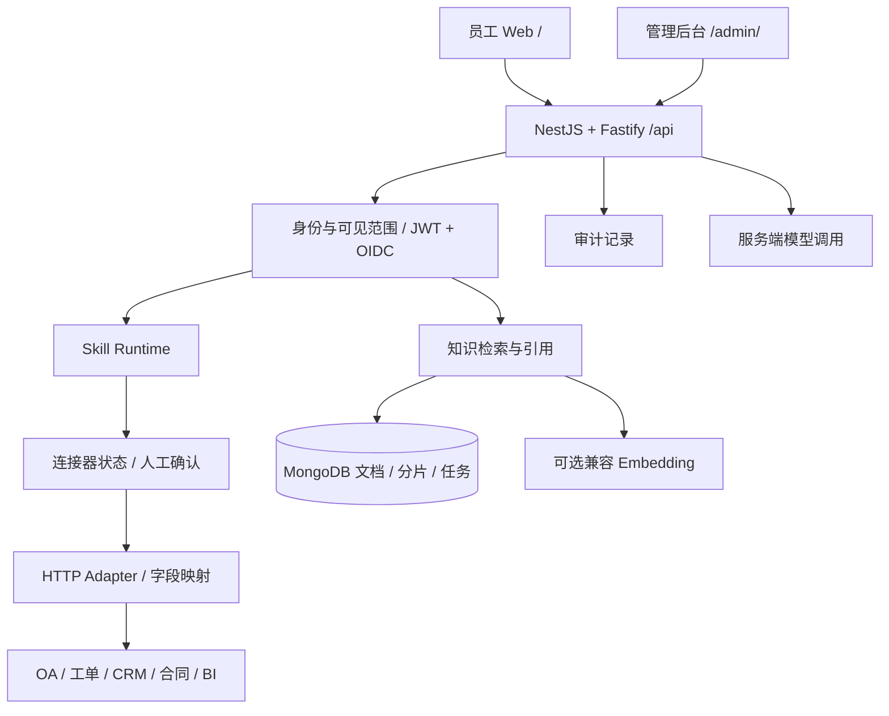

# 技术架构与实现边界

## 两个页面入口，同源部署

`web-app/` 提供员工对话，`admin-web/` 提供管理工作台，两个前端都调用同源 `/api`。生产构建由 `backend/` 同时提供静态资源、页面路由与 API。开发时用 Vite 转发 `/admin` 和 `/api`，保持相同的访问路径。OIDC 会话 Cookie 可在同一域名的两个入口共用。

后端模块共用应用进程，由 MongoDB 保存平台数据和入库队列。文件存储独立配置，默认使用本地目录。

## 知识流

文件上传 → 对象存储接口（默认本地目录）→ MongoDB 持久化导入队列 → Worker 解析 PDF/DOCX/XLSX/CSV/文本等 → 分片与可选 Embedding → 按当前身份过滤检索 → 返回片段与来源。

默认是中文 Bigram 关键词检索；可选向量由兼容 Embedding API 生成，存入 MongoDB，应用层进行混合相关性排序。目前不是专用向量数据库或大规模向量索引。资料会在检索时做权限过滤，但外部模型服务会接收问题、命中片段和工具结果；是否允许出网、采用何种模型，需要组织自行决定。

## Skill 与业务系统

文件结果独立于聊天记录：员工提交正文与格式，MongoDB 保存任务，Worker 原子领取后在本地排版或编码，成功才开放预览和下载。结果查询同时匹配企业、用户和有效期。Tauri 使用同一份员工端与本机 API，原生层仅负责快捷键、选择目录与防覆盖保存。

manifest 描述业务能力、输入、工具和风险。Runtime 只执行已启用的 Skill，检查角色和输入，解析对应连接器；只读查询可执行，写入或高风险动作返回确认请求。确认摘要绑定业务输入、用户上下文和连接器配置，并以数据库条件更新原子消费。

HTTP Adapter 将过滤条件、载荷和可信身份映射为业务接口请求，按响应路径与业务成功码解析结果。连接器配置支持 `operations`，详细示例见 [HTTP 接入](connector-http-integration.md)。OAuth2 续期、自定义签名和业务员工编号映射尚需专用 Adapter；scope 声明尚未形成完整的运行时强制授权。业务系统仍应校验数据权限。

## 已知生产化事项

开发身份模式会使用可构造的请求头，演示数据包含管理员角色，仅用于本机体验。生产应使用 JWT/OIDC 或可信网关，关闭开发登录与演示模式，配置 HTTPS、强随机密钥、模型出网规则、持久化存储和备份，并验证业务授权、幂等、访问日志与资源限制。当前公开版本不宣称完成生产安全审计。
