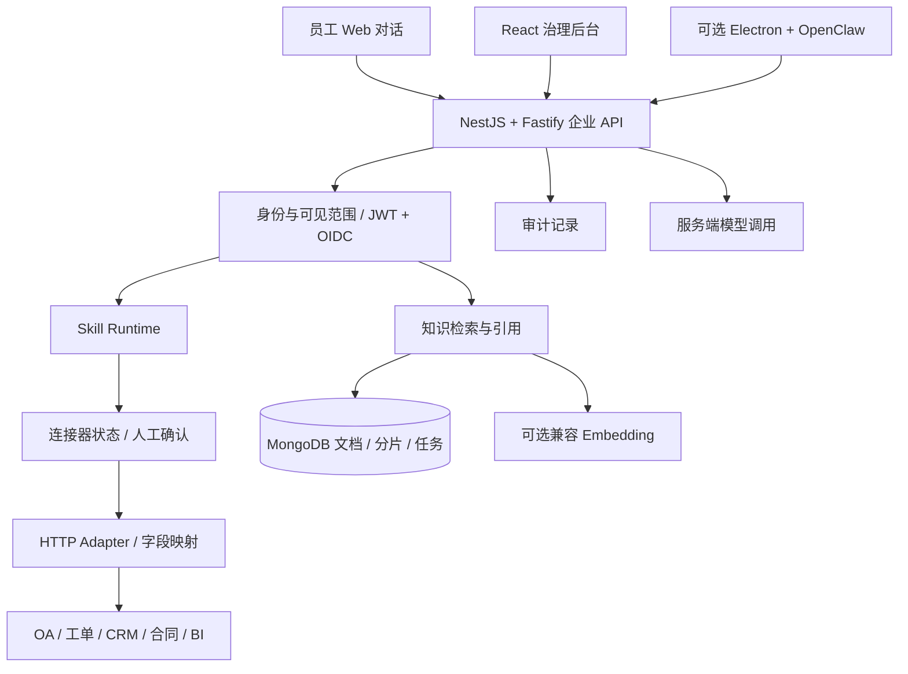

# 技术架构与实现边界

## 三个入口，一套企业后端

`web-app/` 是主要员工入口：不要求安装 Electron 或运行 OpenClaw。`admin-web/` 负责知识、Skill、连接器和审计。`backend/` 负责数据、身份、检索、运行时确认与模型调用。桌面客户端保留本地能力，Renderer 仍经 Main 代理访问企业 API。

## 知识流

文件上传 → 对象存储接口（默认本地目录）→ MongoDB 持久化导入队列 → Worker 解析 PDF/DOCX/XLSX/CSV/文本等 → 分片与可选 Embedding → 按当前身份过滤检索 → 返回片段与来源。

默认是中文 Bigram 关键词检索；可选向量由兼容 Embedding API 生成，存入 MongoDB，应用层进行混合相关性排序。目前不是专用向量数据库或大规模向量索引。资料会在检索时做权限过滤，但外部模型服务会接收问题、命中片段和工具结果；是否允许出网、采用何种模型，需要组织自行决定。

## Skill 与业务系统

manifest 描述业务能力、输入、工具和风险。Runtime 只执行已启用的 Skill，检查角色和输入，解析对应连接器；只读查询可执行，写入或高风险动作返回确认请求。确认摘要绑定业务输入、用户上下文和连接器配置，并以数据库条件更新原子消费。

HTTP Adapter 将过滤条件、载荷和可信身份映射为业务接口请求，按响应路径与业务成功码解析结果。连接器配置支持 `operations`，详细示例见 [HTTP 接入](connector-http-integration.md)。OAuth2 续期、自定义签名和业务员工编号映射尚需专用 Adapter；scope 声明尚未形成完整的运行时强制授权。业务系统仍应校验数据权限。

## 已知生产化事项

开发身份模式会使用可构造的请求头，演示数据包含管理员角色，仅用于本机体验。生产应使用 JWT/OIDC 或可信网关，关闭开发登录与演示模式，配置 HTTPS、强随机密钥、模型出网规则、持久化存储和备份，并验证业务授权、幂等、访问日志与资源限制。当前公开版本不宣称完成生产安全审计。
